# Maquette de l'arbre : situations → événements (règles sourcées)

56 types de situation, 58 types d'événement, 58 arêtes (une par règle sourcée). Les situations produites par chaque événement restent à renseigner (à sourcer) : le graphe ne chaîne pas encore les règles entre elles.

Événements atteints par plusieurs règles (plusieurs étalons pour le même événement) :

- aucun

```mermaid
flowchart LR
  subgraph sans_fiche["(sans fiche)"]
    S6(["campagne de contestation non violente en cours contre un régime"]) -- "regimes_fermes_contestation" --> E6["succès d'une campagne de contestation non violente qui vise un changement de régime"]
    S7(["dirigeant africain au pouvoir face à une limite de mandat"]) -- "afrique_limites_de_mandat" --> E7["maintien au pouvoir d'un dirigeant africain au-delà des limites de mandat"]
    S4(["élection nationale à venir, avec des sondages publiés"]) -- "sondages_erreur_comparee" --> E8["résultat d'une élection nationale prévu d'après les sondages"]
    S8(["élections législatives françaises convoquées"]) -- "france_legislatives" --> E9["élection d'un député ou issue des élections législatives françaises"]
    S9(["élections législatives à venir dans un pays européen"]) -- "seuils_parlements_nationaux_europe" --> E10["entrée d'un parti au parlement national ou répartition des sièges, dans un pays européen"]
    S10(["élections européennes à venir"]) -- "seuils_elections_europeennes" --> E11["sièges obtenus par une liste aux élections européennes"]
    S11(["proposition soumise au vote du Conseil de l'Union européenne"]) -- "ue_majorite_qualifiee" --> E12["adoption d'une décision par le Conseil de l'Union européenne"]
    S12(["sanctions de l'Union européenne contre la Russie en vigueur ou proposées"]) -- "ue_sanctions_russie" --> E13["adoption ou renouvellement des sanctions de l'Union européenne contre la Russie"]
    S13(["élections législatives tenues ou prévues dans une démocratie parlementaire"]) -- "europe_formation_gouvernement" --> E14["formation d'un gouvernement après des législatives dans une démocratie parlementaire"]
    S14(["élection législative à venir"]) -- "voix_vers_sieges" --> E15["conversion des voix en sièges dans une élection législative"]
    S15(["territoire ethnique africain coupé ou non par une frontière coloniale"]) -- "afrique_frontieres_coloniales" --> E16["violence politique dans un territoire ethnique africain"]
    S16(["zone minière africaine face à une variation des prix des minerais"]) -- "afrique_mines_conflits" --> E17["conflit local dans une zone minière africaine"]
    S17(["économies africaines (flux financiers mesurés sur plusieurs années)"]) -- "afrique_flux_financiers_illicites" --> E18["montant des sorties financières illicites d'Afrique"]
    S18(["élection présidentielle prévue ou en cours"]) -- "presidentielles_mode_de_scrutin" --> E19["déroulement ou issue d'une élection présidentielle (à un ou deux tours)"]
    S19(["élection présidentielle indonésienne prévue"]) -- "indonesie_presidentielle" --> E20["issue de l'élection présidentielle indonésienne"]
    S20(["élection de la Chambre des représentants du Japon prévue"]) -- "japon_chambre_basse" --> E21["majorité à la Chambre des représentants du Japon"]
    S21(["élection fédérale australienne prévue"]) -- "australie_vote_preferentiel" --> E22["élection d'un député ou majorité à la Chambre des représentants australienne"]
    S22(["élection de la Lok Sabha prévue"]) -- "inde_scrutin_uninominal" --> E23["élection d'un député ou majorité à la Lok Sabha"]
    S25(["projet de résolution soumis au Conseil de sécurité de l'ONU"]) -- "onu_conseil_securite_vote" --> E26["adoption d'une résolution par le Conseil de sécurité de l'ONU"]
    S28(["présidentielle à deux tours dont le premier tour est connu"]) -- "second_tour_retournement" --> E29["vainqueur du second tour d'une présidentielle à deux tours"]
    S14(["élection législative à venir"]) -- "parlements_mode_de_scrutin" --> E30["issue d'une élection législative selon son mode de scrutin"]
    S29(["élections brésiliennes des gouverneurs ou des sénateurs prévues"]) -- "bresil_gouverneurs_senat" --> E31["élection d'un gouverneur ou d'un sénateur au Brésil"]
    S54(["pape en fonction"]) -- "papes_voyages" --> E56["voyage d'un pape à l'étranger"]
  end
  subgraph calendriers_echeances["calendriers-echeances"]
    S4(["élection nationale à venir, avec des sondages publiés"]) -- "us_erreur_selon_temps_restant" --> E4["résultat d'une élection nationale prévu d'après les sondages, selon le temps restant avant le vote"]
    S30(["politique monétaire américaine entre deux réunions du FOMC"]) -- "us_fed_calendrier" --> E32["décision de taux de la Réserve fédérale américaine"]
    S31(["affaire ou pourvoi pendant devant la Cour suprême américaine"]) -- "us_cour_supreme_calendrier" --> E33["décision, ordonnance ou acceptation d'un pourvoi par la Cour suprême américaine"]
    S33(["exercice budgétaire fédéral américain sans lois de crédits annuelles adoptées"]) -- "us_lois_de_finances_provisoires" --> E35["vote d'une loi de finances provisoire (continuing resolution) ou fermeture du gouvernement fédéral américain"]
    S35(["accord USMCA en vigueur, avant ou pendant sa révision conjointe"]) -- "usmca_revision_conjointe" --> E37["prolongation, révision ou retrait de l'accord États-Unis–Mexique–Canada (USMCA)"]
    S36(["négociation en cours avec une date limite connue"]) -- "effet_d_echeance_negociation" --> E38["conclusion d'un accord négocié avant une date limite"]
    S37(["campagne référendaire en cours sur un changement"]) -- "referendums_retour_statu_quo" --> E39["victoire du changement à un référendum"]
    S42(["projet, chantier ou lancement annoncé avec une date prévue"]) -- "calendriers_annonces_glissent" --> E44["achèvement ou mise en service d'un projet annoncé à la date prévue"]
    S49(["composition du Dow Jones Industrial Average en vigueur"]) -- "dow_jones_changements" --> E51["changement de composition du Dow Jones Industrial Average"]
  end
  subgraph climat_extremes["climat-extremes"]
    S44(["saison cyclonique atlantique en cours ou à venir"]) -- "us_ouragans_atterrissage" --> E46["atterrissage d'un ouragan sur le territoire continental des États-Unis"]
    S46(["série de températures mondiale ou régionale proche de son record"]) -- "records_temperature_persistance" --> E48["record mensuel ou journalier de température de l'air ou de la mer"]
  end
  subgraph competitions_culture["competitions-culture"]
    S47(["phase finale de la Coupe du monde à venir ou en cours, avec ses équipes qualifiées"]) -- "coupe_du_monde_vainqueurs_hotes" --> E49["vainqueur ou parcours d'une équipe à la Coupe du monde de football"]
  end
  subgraph energie_mondiale["energie-mondiale"]
    S52(["pays membre de l'OPEP"]) -- "opep_departs" --> E54["départ ou suspension d'un pays membre de l'OPEP"]
  end
  subgraph humain["humain"]
    S26(["pays exposé à une tentative de coup d'État (taux mondial ou régional)"]) -- "coups_d_etat_frequence" --> E27["tentative ou réussite d'un coup d'État"]
    S27(["chef d'État ou de gouvernement au pouvoir"]) -- "chefs_d_etat_sortie_irreguliere" --> E28["départ forcé (coup, révolte, assassinat) ou maintien au pouvoir d'un chef d'État ou de gouvernement"]
    S48(["ancien chef d'État ou de gouvernement sorti du pouvoir"]) -- "anciens_dirigeants_sort" --> E50["exil, emprisonnement ou poursuite d'un ancien chef d'État ou de gouvernement"]
  end
  subgraph inflation_mondiale["inflation-mondiale"]
    S53(["tarifs de Royal Mail en vigueur"]) -- "royal_mail_hausses_tarifs" --> E55["hausse des tarifs des lettres ou colis de Royal Mail"]
  end
  subgraph non_proliferation["non-proliferation"]
    S43(["programme nucléaire nord-coréen sans essai depuis septembre 2017"]) -- "coree_du_nord_essais_nucleaires" --> E45["essai nucléaire nord-coréen"]
  end
  subgraph politique_americaine["politique-americaine"]
    S0(["campagne présidentielle américaine avant le vote du collège électoral"]) -- "us_president_college" --> E0["issue de l'élection présidentielle américaine (collège électoral)"]
    S1(["primaire américaine en cours dans un État qui prévoit un second tour"]) -- "us_primaires_second_tour" --> E1["issue d'une primaire américaine qui prévoit un second tour"]
    S2(["primaire non partisane ou scrutin préférentiel prévu dans un État américain"]) -- "us_primaires_systemes_speciaux" --> E2["issue d'une primaire non partisane ou d'un vote préférentiel dans un État américain"]
    S3(["élection américaine à venir, avec des sondages publiés"]) -- "us_erreur_sondages_par_echelle" --> E3["résultat d'une élection américaine prévu d'après les sondages"]
    S5(["membre sortant du Congrès américain candidat à sa réélection"]) -- "us_avantage_sortant_congres" --> E5["réélection d'un sortant au Congrès américain"]
    S23(["texte de loi ou nomination soumis au Sénat américain"]) -- "us_senat_cloture" --> E24["adoption d'une loi ou confirmation d'une nomination par le Sénat américain"]
    S24(["Congrès américain en session"]) -- "us_congres_productivite" --> E25["nombre de lois adoptées par le Congrès américain"]
    S32(["projet budgétaire au Congrès américain"]) -- "us_reconciliation_budgetaire" --> E34["adoption d'une loi de réconciliation budgétaire par le Congrès américain"]
    S34(["membre de la Chambre des représentants américaine en fonction"]) -- "us_chambre_sanctions_disciplinaires" --> E36["censure, réprimande ou exclusion d'un membre de la Chambre des représentants américaine"]
    S38(["nomination présidentielle américaine transmise au Sénat"]) -- "us_confirmations_delais" --> E40["confirmation par le Sénat d'une nomination présidentielle américaine"]
    S39(["conseiller principal de la Maison-Blanche ou membre du cabinet américain en fonction"]) -- "us_entourage_rotation" --> E41["départ d'un conseiller principal de la Maison-Blanche ou d'un membre du cabinet américain"]
    S40(["programme de sanctions du Trésor américain en vigueur"]) -- "us_sanctions_frequence" --> E42["nouvelles désignations de sanctions par le Trésor américain (OFAC)"]
    S41(["élu ou responsable public américain, en fonction ou ancien, non inculpé"]) -- "us_inculpation_personnalites" --> E43["inculpation ou arrestation d'un élu ou d'un responsable public américain, en fonction ou ancien"]
  end
  subgraph russie_ukraine["russie-ukraine"]
    S55(["présidents américain et russe en fonction, sans sommet annoncé"]) -- "sommets_etats_unis_russie" --> E57["rencontre en personne entre les présidents américain et russe"]
  end
  subgraph securite_publique["securite-publique"]
    S50(["niveau national de menace terroriste du Royaume-Uni en vigueur"]) -- "royaume_uni_niveau_menace" --> E52["changement du niveau national de menace terroriste du Royaume-Uni"]
    S51(["contrôle temporaire aux frontières intérieures de Schengen en vigueur ou notifié"]) -- "schengen_controles_interieurs" --> E53["levée ou prolongation d'un contrôle temporaire aux frontières intérieures de Schengen"]
  end
  subgraph soleil_espace["soleil-espace"]
    S45(["surveillance satellitaire des explosions de bolides dans l'atmosphère"]) -- "bolides_frequence" --> E47["explosion dans l'atmosphère d'un bolide d'une énergie donnée"]
  end
```

